# Why {stevethemes}? An Introduction

``` r

library(stevethemes)
library(ggplot2)
```

## An Introduction

[stevethemes](https://svmiller.com/stevethemes/) is one of a litany of
[ggplot2](https://ggplot2.tidyverse.org) theme packages that users can
consider for their own purposes. The package itself was very much
inspired by [Bob Rudis’
`{hrbrthemes}`](https://hrbrmstr.github.io/hrbrthemes/) and emerged as a
fork of [my own miscellaneous R functions
package](https://svmiller.com/stevemisc/news/index.html#stevemisc-150)
in order to keep my ecosystem of R packages somewhat discrete. Part of
this is admittedly my own vanity to have a variety of R helper tools
that I find pleasing, help me in my own research, but also make sense to
me.

## Why This Package?

Again, vanity. I am not the most vain person on the planet, but vain
enough to name things “steve”. Further, I have a particular taste in how
graphs should look for my website, my papers, and my in-class
presentations. I also have a particular dialect and a preferred way of
doing things that I found did not often square with how other packages
would want me to accomplish what I wanted to accomplish. I do a lot of
instruction in my current job. It has to make sense to me in order for
me to communicate it to my students.

## What’s Included? And How Should I Use It?

[stevethemes](https://svmiller.com/stevethemes/) has a variety of
functions to use with the plots you make in
[ggplot2](https://ggplot2.tidyverse.org). I’ll go in order of what I
think is important.

### `theme_steve()`

The main impetus behind this package is formalizing my preferred
[ggplot2](https://ggplot2.tidyverse.org) theme,
[`theme_steve()`](https://svmiller.com/reference/theme_steve.md). This
[ggplot2](https://ggplot2.tidyverse.org) theme of mine is forked from
[`theme_bw()`](https://ggplot2.tidyverse.org/reference/ggtheme.html) in
[ggplot2](https://ggplot2.tidyverse.org) and is mostly inspired by how
Bob Rudis presented a lot of his suite of
[ggplot2](https://ggplot2.tidyverse.org) themes. You can get a quick
idea of what it looks like by using the
[`example_plot()`](https://svmiller.com/reference/example_plot.md)
function in this package.
[`example_plot()`](https://svmiller.com/reference/example_plot.md) can
return a variety of graphs, but the default is [a bar chart of CAGEMATCH
ratings for Rick
Martel](https://svmiller.com/stevethemes/reference/martel_ratings.html).
Against a default [ggplot2](https://ggplot2.tidyverse.org) theme, it
would look like this.

``` r

example_plot()
```

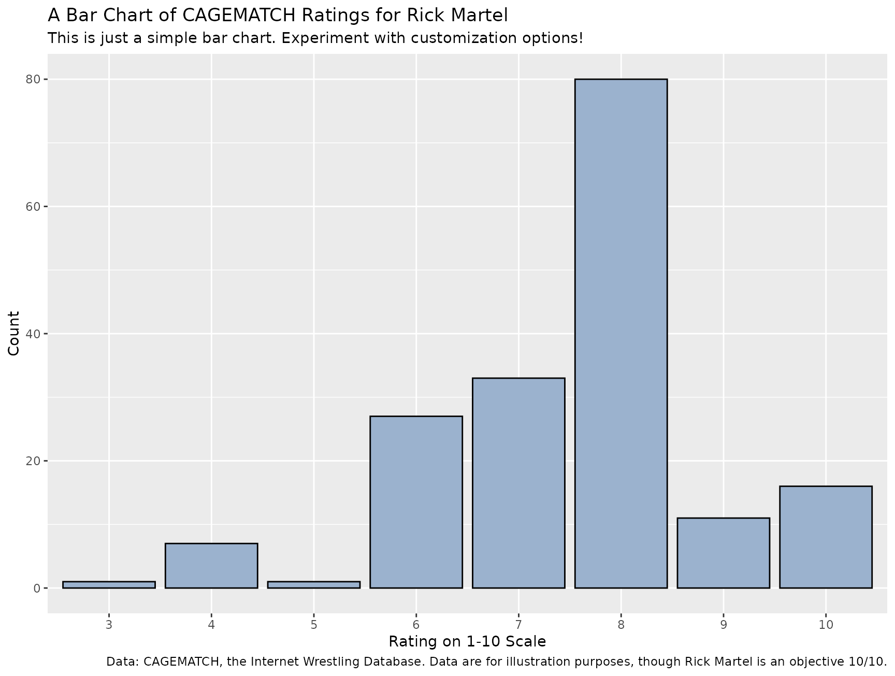

With my preferred theme, it would look like this:

``` r

example_plot() + theme_steve()
```

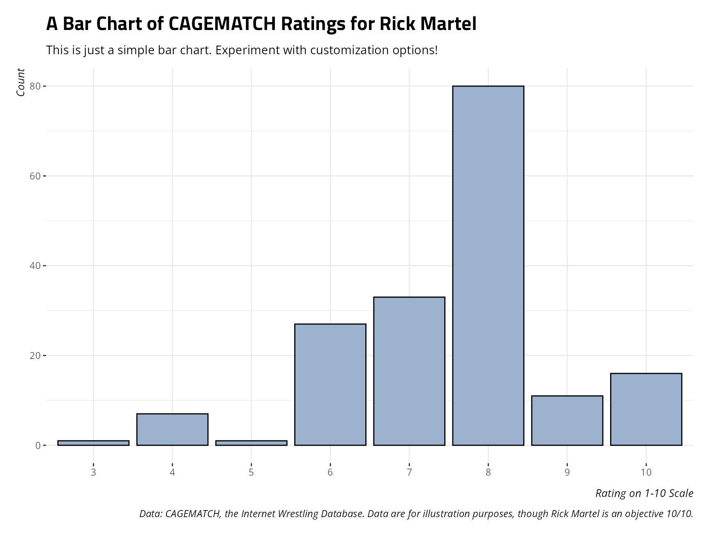

Notice that these design choices are everywhere on [my academic
website](https://svmiller.com). My preferred online font is Open Sans
and my sections use Titillium Web. Those are the fonts this function
uses. The use of Titillium Web, in particular, dates to [Alex
King](https://alexking.org/) and my introduction to him when I was still
a university student learning about web design.

[`theme_steve()`](https://svmiller.com/reference/theme_steve.md) comes
in several flavors, using the `style` argument in this function. These
are
[“web”](https://svmiller.com/stevethemes/articles/default-example.html)
(the default), “generic”,
[“ms”](https://svmiller.com/stevethemes/articles/ms-example.html),
[“merri”](https://svmiller.com/stevethemes/articles/merriweather-example.html),
[“fira”](https://svmiller.com/stevethemes/articles/fira-example.html),
and “custom”. This particular vignette links to other vignettes that
make liberal use of those themes. “generic” will make use of
system-ready sans serif fonts in the absence of more specific fonts this
function references. If `style` is “custom”, the user must also specify
something in the `font` argument that matches a font available on the
user’s system. I have a vignette that shows [what this looks like in
Papyrus](https://svmiller.com/stevethemes/articles/papyrus-example.html).
Perhaps a better use of this is a font that Bob Rudis highlights is
underappreciated: Arial Narrow. Arial Narrow is a great font that’s
widely available, often by default, and has great solid default kerning
pairs. Here is what it would look like paired with
[`theme_steve()`](https://svmiller.com/reference/theme_steve.md).

``` r

example_plot() + theme_steve(style = 'custom', font = "Arial Narrow")
```

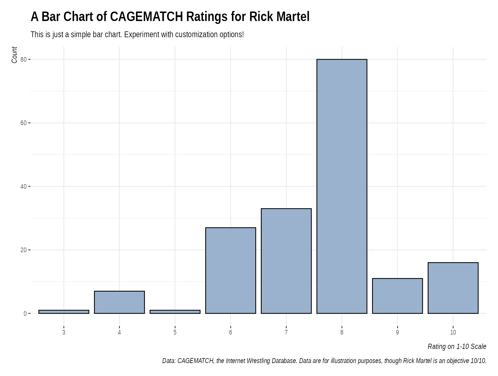

### Grab a color with `g_c()`, from `steve_hex`

My preferred [ggplot2](https://ggplot2.tidyverse.org) dialect likes to
avoid custom functions to supply colors and fills for basic plots when I
can just as well use default functions in
[ggplot2](https://ggplot2.tidyverse.org), like
[`scale_color_manual()`](https://ggplot2.tidyverse.org/reference/scale_manual.html),
[`scale_fill_manual()`](https://ggplot2.tidyverse.org/reference/scale_manual.html),
or supply a fill in the particular geom. For example, I could reproduce
the plot above as follows.

``` r

ggplot(martel_ratings, aes(as.factor(value))) +
      labs(title = "A Bar Chart of CAGEMATCH Ratings for Rick Martel",
           x = "Rating on 1-10 Scale", y ="Count",
           caption = "Data: CAGEMATCH, the Internet Wrestling Database. Data are for illustration purposes, though Rick Martel is an objective 10/10.",
           subtitle = "This is just a simple bar chart. Experiment with customization options!") +
      geom_bar(fill=g_c("su_water"), alpha=1, color='black') +
  theme_steve(style = 'generic') # a preview of style = generic
```

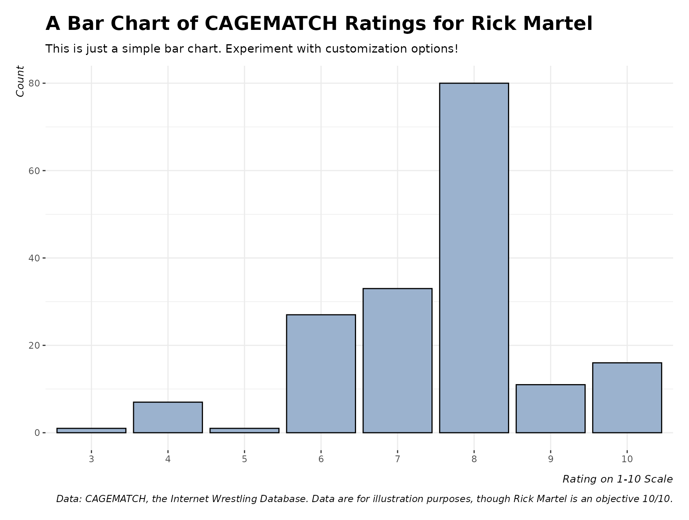

In the above, notice what the
[`g_c()`](https://svmiller.com/reference/g_c.md) function is doing. The
`fill` argument is given by
[`geom_bar()`](https://ggplot2.tidyverse.org/reference/geom_bar.html),
but the [`g_c()`](https://svmiller.com/reference/g_c.md) takes a
character that corresponds with an entry in [the `steve_hex` data
frame](https://svmiller.com/stevethemes/reference/steve_hex.html) and
supplies the hex triplet that the character is describing. Observe:

``` r

g_c("su_water")
#> [1] "#9bb2ce"
steve_hex[steve_hex$color == "su_water",]
#> # A tibble: 1 × 2
#>   color    hex    
#>   <chr>    <chr>  
#> 1 su_water #9bb2ce
```

For context, this is the color that Stockholm University describes as
[its “water”
color](https://medarbetare.su.se/en/our-su/communicate-su/graphic-profile/colours).
`steve_hex` has a host of available colors for that
[`g_c()`](https://svmiller.com/reference/g_c.md) will get. For example,
as this is Rick Martel, I can use his particular baby blue color, which
I call `martel_eau` in homage to both his character and his French
Canadian heritage.

``` r

g_c("martel_eau")
#> [1] "#70c6df"

ggplot(martel_ratings, aes(as.factor(value))) +
      labs(title = "A Bar Chart of CAGEMATCH Ratings for Rick Martel",
           x = "Rating on 1-10 Scale", y ="Count",
           caption = "Data: CAGEMATCH, the Internet Wrestling Database. Data are for illustration purposes, though Rick Martel is an objective 10/10.",
           subtitle = "This is just a simple bar chart. Experiment with customization options!") +
      geom_bar(fill=g_c("martel_eau"), alpha=1, color='black') +
  theme_steve()
```

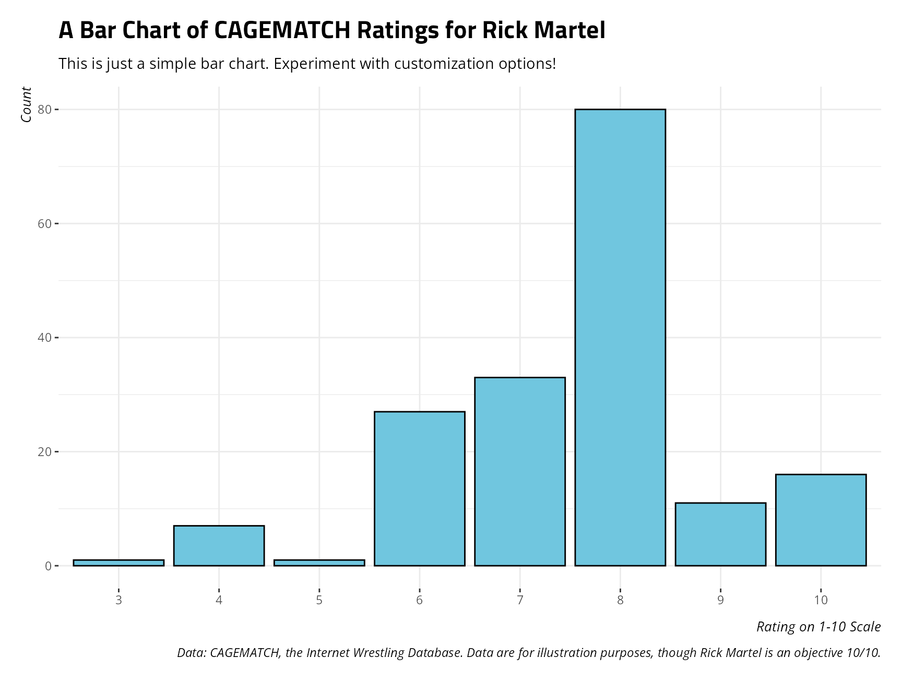

`steve_hex` is a simple data set of hex triplets that I like and/or find
useful and interesting. [`g_c()`](https://svmiller.com/reference/g_c.md)
is a convenience function that extracts those hex triplets by some kind
of more intuitive name to use for simple cases where color or fill are
identified in the particular geom in
[ggplot2](https://ggplot2.tidyverse.org).

### Load a palette with `spal()`

I’ll be honest that I could never remember how exactly to supply a
palette in [ggplot2](https://ggplot2.tidyverse.org), certainly when
third-party packages were under consideration. I would always manually
do this with
[`scale_color_manual()`](https://ggplot2.tidyverse.org/reference/scale_manual.html)
or
[`scale_fill_manual()`](https://ggplot2.tidyverse.org/reference/scale_manual.html).
It was what I could remember. Around 8 years ago or so, I was using
[Dataroots’ `{artyfarty}`
package](https://github.com/datarootsio/artyfarty/) for experimenting
with custom color palettes. It had a `pal()` package it would use and
supply in something like
[`scale_color_manual()`](https://ggplot2.tidyverse.org/reference/scale_manual.html)
or
[`scale_fill_manual()`](https://ggplot2.tidyverse.org/reference/scale_manual.html).
I ended up taking some initiative to rewrite what that function did,
using some of the same basic logic.
[`spal()`](https://svmiller.com/reference/spal.md) defines palettes that
are listed by name and description in [the `palettes` data
frame](https://svmiller.com/stevethemes/reference/palettes.html). You
only need to know whether you want to use a qualitative, sequential, or
diverging palette. Palettes are defined initially by a leading “q”
(qualitative), “s” (sequential), or “d” (diverging). `palettes` has the
list of available palettes.

``` r

palettes
#> # A tibble: 26 × 2
#>    palette description                                      
#>    <chr>   <chr>                                            
#>  1 d-suFB  "Diverging Palette (SU \"Fire\" to SU Blue)"     
#>  2 d-suBF  "Diverging Palette (SU Blue to SU \"Fire\")"     
#>  3 d-suRB  "Diverging Palette (SU Red to SU Blue)"          
#>  4 d-suBR  "Diverging Palette (SU Blue to SU Red)"          
#>  5 d-suRW  "Diverging Palette (SU Red to SU \"Water\")"     
#>  6 d-suWR  "Diverging Palette (SU \"Water\" to SU Red)"     
#>  7 d-suBO  "Diverging Palette (SU Blue to SU Olive)"        
#>  8 d-suOB  "Diverging Palette (SU Olive to SU Blue)"        
#>  9 d-suFW  "Diverging Palette (SU \"Fire\" to SU \"Water\")"
#> 10 d-suWF  "Diverging Palette (SU \"Water\" to SU \"Fire\")"
#> # ℹ 16 more rows

palettes$palette
#>  [1] "d-suFB"       "d-suBF"       "d-suRB"       "d-suBR"       "d-suRW"      
#>  [6] "d-suWR"       "d-suBO"       "d-suOB"       "d-suFW"       "d-suWF"      
#> [11] "s-suB"        "s-suO"        "s-suR"        "s-suF"        "s-suS"       
#> [16] "s-suW"        "q-supair"     "q-su70"       "q-OI"         "q-google"    
#> [21] "q-ibm"        "q-wong"       "q-tolm"       "q-sciencespo" "q-dataroots" 
#> [26] "q-martel"
```

#### Qualitative Palettes

Qualitative palettes color-code or fill categorical differences when the
underlying thing being colored or filled can only communicate
differences without any kind of order or numerical precision. As an
illustration of this, consider another example plot I created of the
distribution of IMF quotas, over time, for some select actor groupings.

``` r

example_plot(type = "imfquotas") + theme_steve()
```

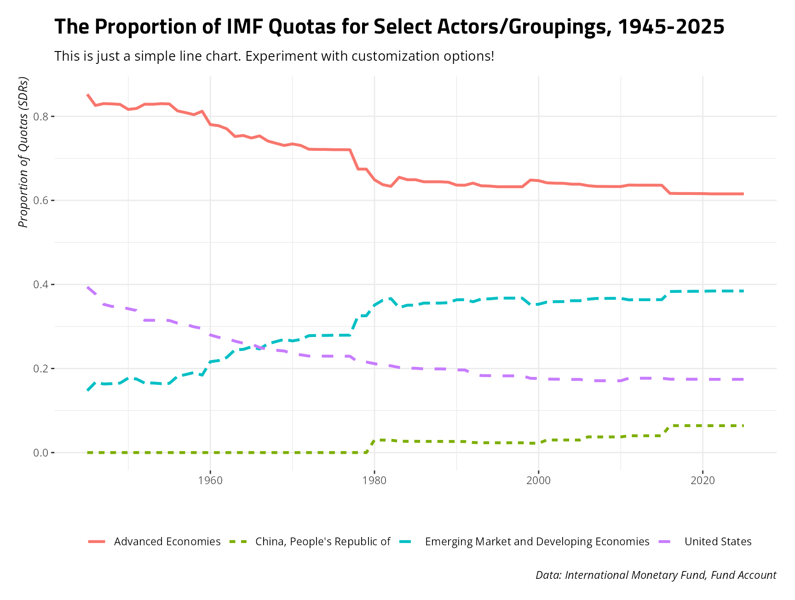

I use these data when talking to students about the design of the
International Monetary Fund (IMF), and how patent it is that rich
countries have the bulk of the voting authority in the IMF. Beyond the
substantive point, I have four colors and four line types for the four
different actors in the data. If I wanted to supply a qualitative
palette of Rick Martel colors in lieu of the default colors, I would add
the following line to my plot, importantly using the
[`spal()`](https://svmiller.com/reference/spal.md) function.

``` r

example_plot(type = "imfquotas") + theme_steve() +
  scale_color_manual(values = spal("q-martel"))
```

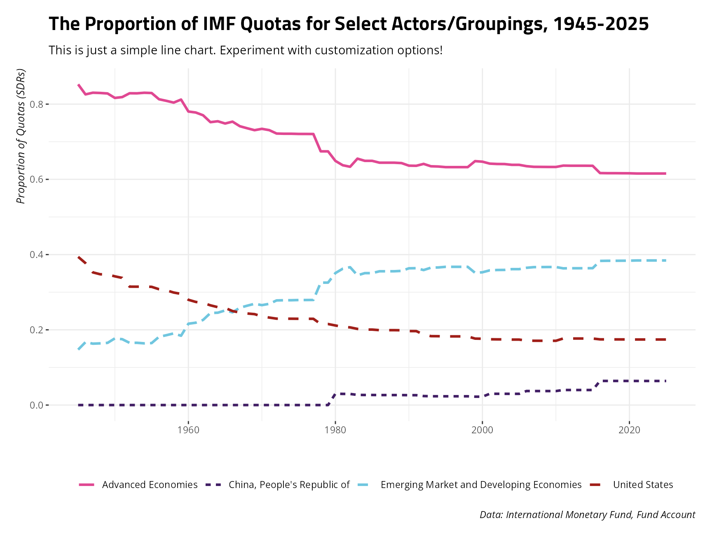

If you’d like to see these colors, just ask for them in
[`spal()`](https://svmiller.com/reference/spal.md). In this case, you
don’t get a fifth and final color (black), but you do get Rick Martel’s
pink, purple, “eau”, and a shade of red that implies his occasional red
jacket from his AWA days or the red in Strike Force.

``` r

spal("q-martel")
#> [1] "#e04892" "#411e65" "#70c6df" "#a01f19" "#000000"
```

#### Diverging Palettes

Diverging palettes fill or color-code differences when the underlying
thing being colored or filled have polar opposites. Consider a
hypothetical Likert item from 1 (“Strongly Disagree”) to 5 (“Strongly
Agree”) or, as you’ll see next, an American partisanship example where
devout Democrats and devout Republicans sit on opposite ends of the
scale. In this case, going from a 7 (“Strong Republican”) to a 1
(“Strong Democrat”) is doing more than just communicating the absence of
Republican affinity.

I’m working on a project now with a colleague about attitudes about
trade protectionism for which the United States is interesting for any
number of reasons. When I would teach American students about trade
protectionism, I would mention how easy it is to prime Americans to do
things that are impermissible under the rules of the World Trade
Organization if you add an American flag or some other jingoistic prompt
to it. For example, the American National Election Studies often asks
respondents whether they would favor policy to limit foreign imports in
order to protect American jobs. The partisan responses to this used to
follow a pattern that I knew well when I was younger: trade
protectionism was historically the domain of the left, and not the
right. Even John McCain was [ringing that bell under what was the most
inopportune time to ring
it](https://abcnews.com/Politics/story?id=4707110&page=1). Now, it looks
quite a lot different, though people who have [read John
Zaller](https://en.wikipedia.org/wiki/The_Nature_and_Origins_of_Mass_Opinion)
and have been awake for the past 10 years will know exactly what
happened.

``` r

example_plot("anes-protect") + theme_steve()
```

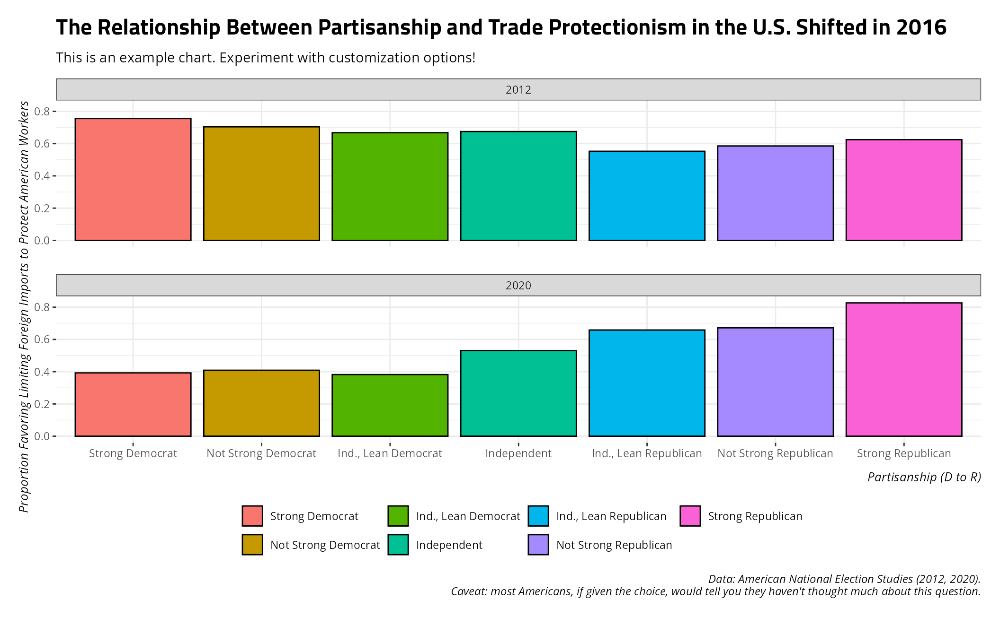

Right now, this plot isn’t terribly readable because the default fill
[ggplot2](https://ggplot2.tidyverse.org) is using thinks these are
qualitative categories. They’re not; they’re ordered categorical and the
extremes map to party colors of blue (for Democrats) and red (for
Republicans). This fill wants to be diverging.
[stevethemes](https://svmiller.com/stevethemes/) has a suite of
diverging palettes using Stockholm University colors. In particular,
“d-suBR” (`d`iverging, using `S`tockholm `U`niversity `B`lue to `R`ed)
is a good candidate for these data. I could call it using the
[`spal()`](https://svmiller.com/reference/spal.md) function in the
[`scale_fill_manual()`](https://ggplot2.tidyverse.org/reference/scale_manual.html)
function from [ggplot2](https://ggplot2.tidyverse.org).

``` r

example_plot("anes-protect") + theme_steve() +
  scale_fill_manual(values = spal("d-suBR", n = 7, d.mid = "#F7F7F7"))
```

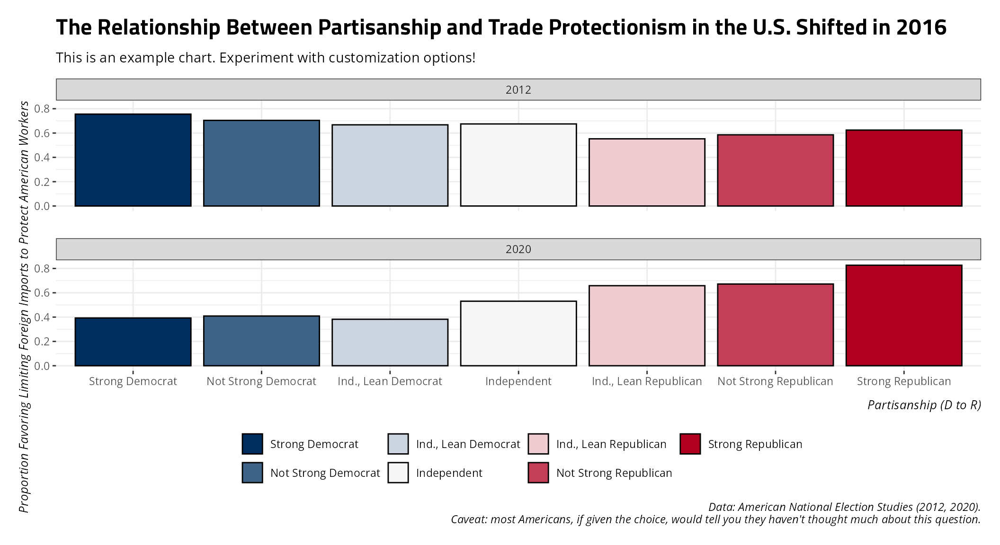

Diverging palettes, as they are right now, are built around use on an
ordered categorical scale. The max right now is 9. If you have fewer
than nine categories, which we have here, you’ll want to specify how
many you have (here: `n = 7`) to help
[`spal()`](https://svmiller.com/reference/spal.md) find the optimal
balance between coloring both extremes. This isn’t necessary, but it’s
helpful. Observe the `d.mid` argument here too. You can optionally set a
color to be the midway point when the number of colors requested is an
odd number (which we have here). The default is “#F7F7F7” (a color
slightly off-white). I’m basically specifying it here to show that you
can adjust this to your taste if you like.

#### Sequential Palettes

Sequential palettes fill or color-code differences that are functionally
granular and quantitative, even if they may manifest in an
ordered-categorical scale. They differ from diverging palettes because
they are intended for quantitative information in which there is no
“fence” or where the middle of scale has no real qualitative meaning. In
the above examples referencing American partisanship and Likert items,
the middle points constitute a kind of “fence”. In a Likert item, these
are people who neither agree nor disagree. On either side of that
particular midway point, they agree or disagree. In American
partisanship, the fence are those who ([are likely a bit dishonest when
they](https://www.politico.com/magazine/story/2014/01/independent-voters-partisans-in-the-closet-101931/))
say they are pure independents. On either side, they must at least lean
in one direction. By contrast, sequential palettes are appropriate when
the thing being colored or filled has a midway point that has no real
meaning.

For one example, let’s consult the recent 2026 Senate election in my
previous state of South Carolina. I have these data available as
`SC26SE`.

``` r

SC26SE
#> # A tibble: 2,185 × 17
#>     long   lat group order county      aan   aap   dgn dgp      mn    mp    tv
#>    <dbl> <dbl> <dbl> <int> <chr>     <dbl> <dbl> <dbl> <chr> <dbl> <dbl> <dbl>
#>  1 -82.2  34.4     1     1 Abbeville  3415  37.8  5364 59.43 -1949 -21.6  9026
#>  2 -82.3  34.4     1     2 Abbeville  3415  37.8  5364 59.43 -1949 -21.6  9026
#>  3 -82.3  34.3     1     3 Abbeville  3415  37.8  5364 59.43 -1949 -21.6  9026
#>  4 -82.3  34.3     1     4 Abbeville  3415  37.8  5364 59.43 -1949 -21.6  9026
#>  5 -82.3  34.3     1     5 Abbeville  3415  37.8  5364 59.43 -1949 -21.6  9026
#>  6 -82.3  34.3     1     6 Abbeville  3415  37.8  5364 59.43 -1949 -21.6  9026
#>  7 -82.2  34.2     1     7 Abbeville  3415  37.8  5364 59.43 -1949 -21.6  9026
#>  8 -82.2  34.2     1     8 Abbeville  3415  37.8  5364 59.43 -1949 -21.6  9026
#>  9 -82.2  34.2     1     9 Abbeville  3415  37.8  5364 59.43 -1949 -21.6  9026
#> 10 -82.3  34.1     1    10 Abbeville  3415  37.8  5364 59.43 -1949 -21.6  9026
#> # ℹ 2,175 more rows
#> # ℹ 5 more variables: pop <dbl>, area <dbl>, whitep <dbl>, blackp <dbl>,
#> #   mcat <fct>
```

As you can perhaps already tell, these data are begging to be a map. For
illustration’s sake, we can map the counties of South Carolina by what
percentage of the population is black. The Deep South is conspicuous for
having some majority black counties that you don’t see the same way in
American states that weren’t previously part of the Confederacy. We have
data by way of the 2020 U.S. Census for what percent of the county is
black (non-Hispanic). We can create some categories for that based on
what I already know are the minimum (Pickens, where I used to live:
6.4%) and the maximum (Allendale, 70.2%).

``` r

Data <- SC26SE

Data$bcat <- cut(Data$blackp, breaks = c(0, 10, 20, 30, 40, 50, 60, 70, 80, 90),
                    right = FALSE)


# Reverse order.
Data$bcat <- factor(Data$bcat, levels = rev(levels(Data$bcat)))
```

Now, let’s create a map with this information.

``` r

ggplot(Data, aes(long, lat, group = group, fill = bcat)) +
  geom_polygon(colour = "grey50") +
  theme_steve() +
  no_gridlines() + # Novelty function for removing gridlines, def. for maps.
  no_axes() +  # Novelty function; your audience won't care about long/lat coordinates in this context.
  scale_fill_manual(values = spal("s-suB", n = 8)) +
  labs(title = "The Percentage of South Carolina That is Black, Non-Hispanic",
       x = "", y = "", fill = "% Black (Non-Hispanic)",
       subtitle = "South Carolina's majority black counties are largely south of Columbia, where the area was fertile for agriculture.")
```

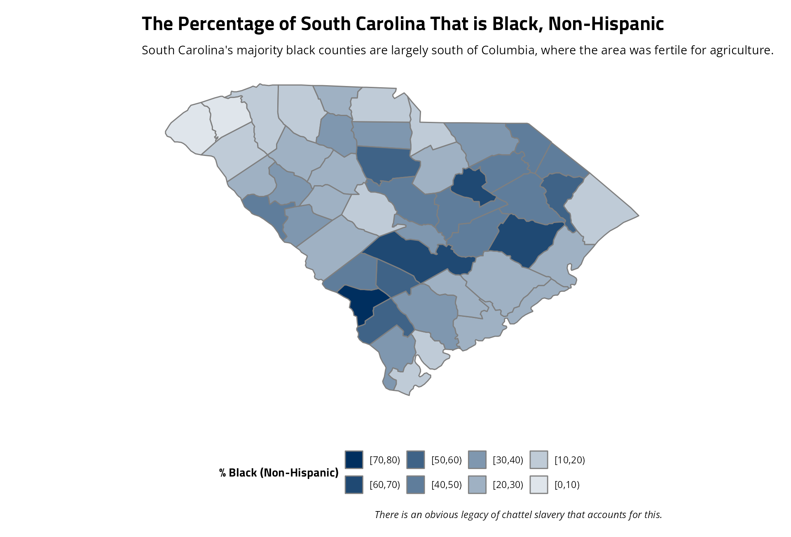

The only real quirk with the sequential palettes in this function is
they do require the use of the `n` argument. They also all use (for the
moment) Stockholm University colors and whiten to be a minimum of 1/n of
their original color (i.e. the lightest color in a sequential palette of
Stockholm University blue is one that is 1/8th of the original blue in
the above example).

While we’re at it, I put together these data to commemorate the 2026
Senate election of Annie Andrews. It’s another map example in which you
can experiment with the fill argument, as so.

``` r

example_plot("annie-andrews") +
  theme_steve() +
  scale_fill_manual(values = spal("d-suRW")) +
  coord_sf() + 
  no_gridlines() +
  no_axes() 
```

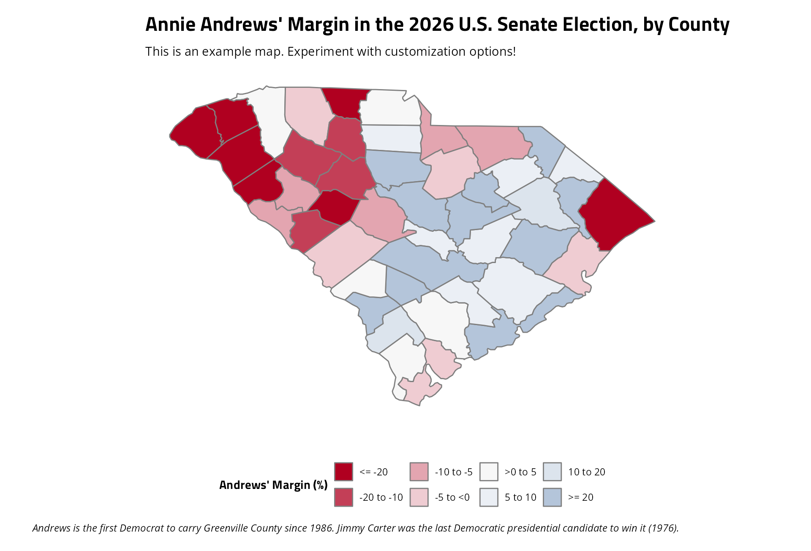
